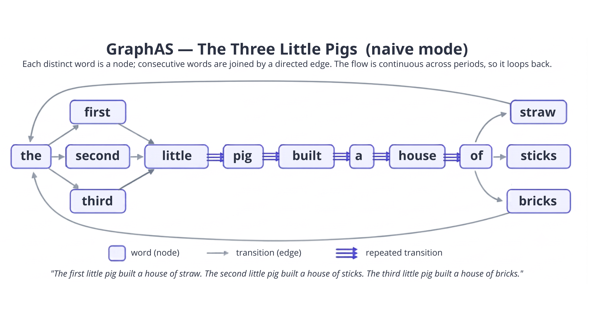

# Graphas


A Python module for **speech graph analysis**: it represents a speech transcription as a directed word graph and extracts the structural features used to quantify how organized or fragmented a discourse is. The approach is language-agnostic and needs no linguistic pre-processing or reference corpus, so it works on oral or written narratives (dream reports, image descriptions, story retellings, memory accounts).

The original code (**v0.0**) was written by Facundo Carrillo for Python 2.7 and ported to Python 3 (**v0.1**) by Carlos Gomes; this repository continues that work (**v1.0**) with a refactored, extensible implementation.

## Table of contents

1. [What is a speech graph?](#what-is-a-speech-graph)
2. [Installation](#installation)
3. [Project structure](#project-structure)
4. [Creating a speech graph](#creating-a-speech-graph)
5. [Graph modes](#graph-modes)
6. [Output features](#output-features)
7. [Sliding-window analysis](#sliding-window-analysis)
8. [Batch analysis](#batch-analysis)
9. [Cite this package](#cite-this-package)
10. [License](#license)
11. [Authorship history](#authorship-history)

## What is a speech graph?

A **speech graph** is a directed graph built from text (typically a speech transcription):

- every distinct token becomes a **node**,
- two nodes are joined by a directed **edge** when their tokens occur consecutively in the flow of speech.

Because tokens repeat, the structure is a directed **multigraph** (`networkx.MultiDiGraph`): parallel edges, self-loops and cycles are meaningful and measured explicitly. The method is **language-agnostic** and requires **no linguistic pre-processing or reference corpus** — it works on oral or written narratives (dream reports, image descriptions, story retellings, memory accounts). The shape of the graph — how connected or fragmented it is — is a quantitative marker of discourse organization.

The figure below illustrates the method on the *Three Little Pigs* text (naive mode): each distinct word is a node, consecutive words are joined by a directed edge, and — because the word flow is continuous across the periods — the graph loops back on itself.



## Installation

Requires **Python ≥ 3.10** (the CLI uses structural `match`). Tested on CPython **3.10, 3.11 and 3.12**.

### From PyPI

```sh
pip install graphas
```

### From source (development)

```sh
# clone and enter the project
git clone https://github.com/nlp-pucrs/graphas.git
cd graphas

# create and activate a virtual environment
python3 -m venv .venv
source .venv/bin/activate

# install the package in editable mode with the dev extras (pytest + ruff)
pip install -e ".[dev]"
```

Runtime dependencies (declared in `pyproject.toml`): `numpy`, `scipy`, `nltk`, `networkx`, `unidecode`, `joblib`. Optional extras: `dev` (pytest, ruff), `doc` (Sphinx docs), `full`. On the first graph construction the library downloads the NLTK `popular` data package automatically.

## Project structure

```txt
graphas/
├── pyproject.toml      # build config, dependencies, CLI entry point, tooling
├── graphas/            # the importable package (flat layout)
│   ├── __init__.py     #   public API + __version__
│   ├── __main__.py     #   `python -m graphas`
│   ├── cli.py          #   console entry point (argparse)
│   ├── batch.py        #   batch analysis (flat rows + CSV feature tables)
│   ├── graphs/         #   graph.py (construction), statistics.py (measurement),
│   │                   #   windows.py (sliding-window analysis)
│   └── const/          #   app.py (metadata), funct.py (supported modes/languages)
├── models/             # pre-trained models
│   └── pos_tag/pt/     #   Portuguese POS taggers (unigram/bigram/brill)
├── docs/               # documentation & resources
│   └── examples/       #   sample input texts (.txt)
└── img/                # graphas_three_little_pigs.png (text → graph illustration)
```

- `graphas/` is the only code shipped as the library; everything else supports development, documentation or examples.

## Creating a speech graph

### Configuration

The behavior is controlled entirely through CLI flags (`graphas -h`):

| Flag | Argument | Description | Default |
|------|----------|-------------|---------|
| `-t` | text(s) | One or more texts to analyze (this or `--csv` is required). | — |
| `--csv` | path | Batch mode: CSV dataset with one transcription per row. | `None` |
| `--text-column` | name | Transcription column of the `--csv` dataset. | `text` |
| `--id-column` | name | Id column of the `--csv` dataset. | row position |
| `-o`, `--output` | path | Write the results as a CSV feature table (one row per text). With `--csv` and no `-o`, the table goes to stdout. | print |
| `-g` | `naive` \| `stem` \| `pos` | Graph mode (node representation). | `naive` |
| `-l` | language | Language for the NLTK tokenizer/stemmer. | `portuguese` |
| `-p` | path | Path to a custom pickled POS tagger. | `None` |
| `-s`, `--stopwords` | — | Skip stopwords when building the graph (`naive` and `stem` modes). | off |
| `-w`, `--window` | size | Sliding-window analysis: window size in words. Omit for whole-text analysis. | `None` |
| `--stride` | stride | Words the sliding window advances at a time (with `-w`). | `1` |
| `-v`, `--version` | — | Print the version and exit. | — |

Supported languages (`graphas/const/funct.py`): arabic, danish, dutch, english, finnish, french, german, hungarian, italian, norwegian, portuguese, romanian, russian, spanish, swedish.

> **POS mode:** NLTK's built-in tagger supports only English (`eng`) and Russian
> (`rus`). For other languages, pass a custom tagger with `-p` — pre-trained
> Portuguese taggers are available in the repository under
> [`models/pos_tag/pt/`](https://github.com/nlp-pucrs/graphas/tree/master/models/pos_tag/pt)
> (they are not part of the PyPI package). Stopword removal (`-s`) does not
> apply to POS mode: the tagger needs the full token sequence.

### From Python

```python
import graphas

g = graphas.naiveGraph("english")
g.analyzeText(
    "The first little pig built a house of straw. "
    "The second little pig built a house of sticks. "
    "The third little pig built a house of bricks."
)
```

### From the command line

Naive graph from the *Three Little Pigs* text (the example illustrated above):

```sh
graphas \
  -g naive \
  -l english \
  -t "The first little pig built a house of straw. The second little pig built a house of sticks. The third little pig built a house of bricks."
```

Output — one feature dictionary per input text (line-wrapped for readability, keys in the order the library emits them; `sLCC` / `sLSC` are the node **sets** of the largest components):

```txt
{'K': 27, 'N': 13, 'E': 26,
 'RE': 10, 'PE': 0, 'CC': 1,
 'sLCC': {'the', 'first', 'little', 'pig', 'built', 'a', 'house', 'of',
          'straw', 'second', 'sticks', 'third', 'bricks'},
 'sLSC': {'the', 'first', 'little', 'pig', 'built', 'a', 'house', 'of',
          'straw', 'second', 'sticks', 'third'},
 'LCC': 13, 'LSC': 12,
 'ATD': 4.0, 'density': 0.2051, 'diameter': 5, 'ASP': 2.5769,
 'LC': 0.0, 'CH': 1.352,
 'CS': 0.3887, 'WC': 3,
 'L1': 0, 'L2': 0, 'L3': 0}
```

The 10 **repeated edges** (`RE`) are the parallel edges along the shared *"little → pig → built → a → house → of"* spine. Because the word flow is **continuous across the periods** (only a line break would cut it), *"straw"* and *"sticks"* link back to *"the"*, closing the graph into a single large cycle of 12 nodes (`LSC = 12` — every word except the final *"bricks"*).

Reading the text from an example file in `docs/examples/`:

```sh
graphas -g naive -l english -t "$(cat docs/examples/example_en.txt)"
```

Portuguese POS graph with a custom tagger (from a clone of the repository):

```sh
graphas \
  -g pos \
  -l portuguese \
  -p models/pos_tag/pt/POS_tagger_brill.pkl \
  -t "o rato roeu a roupa do rei de roma"
```

## Graph modes

Modes differ only in **how a token is normalized into a node**; the edge rule (consecutive tokens) is identical.

- **Naive graph** — words with no transformation. One node per distinct word.
- **Stem graph** — words after **stemming** (NLTK `SnowballStemmer`); surface variants collapse to one node (*love*, *loved*, *loving* → `love`).
- **Part-of-Speech (POS) graph** — each word replaced by its **grammatical category**, capturing syntactic rather than lexical structure.

Pipeline (all modes): line segmentation (split on line breaks only — punctuation such as periods and commas does **not** break the flow) → cleaning (lowercase, strip, remove non-word characters) → tokenization + normalization + optional stopword filtering → build
`MultiDiGraph` from consecutive tokens → extract features.

## Output features

For every graph the module computes:

| Feature | Description |
|---------|-------------|
| `K` | Token count of the preprocessed text (whole-text analysis; `N <= K`, and `N/K` measures lexical diversity). |
| `N` | Number of nodes. |
| `E` | Number of edges. |
| `RE` | Repeated edges — extra same-direction edges beyond the first (parallel edges). |
| `PE` | Parallel edges (reference definition): unordered pairs connected in **both** directions. |
| `CC` | Number of weakly connected components. |
| `sLCC` / `LCC` | Set / count of nodes in the largest **weakly** connected component. |
| `sLSC` / `LSC` | Set / count of nodes in the largest **strongly** connected component. |
| `L1` / `L2` / `L3` | Loops of one / two / three nodes (traces of A, A², A³). |
| `ATD` | Average total degree: mean in+out degree per node, parallel edges counted (`2E/N`). |
| `density` | Fraction of possible node pairs that are connected, on the undirected simple projection with self-loops excluded (`2|E_u| / N(N-1)`). |
| `diameter` | Longest shortest path, on the undirected simple view of the largest weakly connected component. |
| `ASP` | Average shortest path length, on the same LCC view. |
| `LC` (local cohesion) | Mean fraction of a node's neighbors that are also connected to one another (average clustering coefficient), on the undirected simple view of the graph. |
| `CH` (connectivity heterogeneity) | Diversity of node connectivity (Shannon entropy of the degree distribution of the undirected simple projection): low when all nodes are similarly connected, high when hubs coexist with peripheral nodes. |
| `CS` / `WC` (community strength / word communities) | How sharply the graph separates into densely connected node groups (modularity of the Clauset–Newman–Moore greedy partition, deterministic) and the number of such groups. |

This matches the static feature set of the reference SpeechGraphs software (**RE, ATD, density, diameter, ASP** and the clustering coefficient, `LC`).

## Sliding-window analysis

Longer texts produce larger graphs, so raw whole-text features confound discourse organization with verbosity. The **sliding window** is the reference control: *T* graphs of identical word count are built by sliding a window of *W* words (default 30) with stride *S* (default 1) over the token flow of the whole transcription. The window **ranges** across line breaks, but the edge rule is the same as the whole-text graph: a line break still cuts the edge inside a window.

```python
import graphas

g = graphas.naiveGraph("english")
res = g.analyzeWindows(text, window_size=30, stride=1)
```

Or from the command line: `graphas -g naive -l english -w 30 -t "..."`.

The result dictionary contains:

| Key | Description |
|-----|-------------|
| `window_size` / `stride` / `K` | The run parameters and the token count of the flow. |
| `number_of_windows` | *T*, the number of windows built. |
| `windows` | The full static feature dictionary of every window, in order. |
| `mean` / `std` | Per-window aggregates of every scalar feature (the verbosity-controlled measures). |
| `TP` (transition persistence) | Mean overlap between the word transitions of consecutive windows (Jaccard similarity of their directed edge sets). |
| `VP` (vocabulary persistence) | Mean overlap between the vocabularies of consecutive windows (Jaccard similarity of their node sets). |
| `VT` (vocabulary turnover) | Mean fraction of each window's words that are new (absent from the previous window). |
| `TT` (transition turnover) | Mean fraction of each window's transitions that are new (absent from the previous window). |
| `CV` (connectedness volatility) | Mean absolute change in the size of the largest strongly connected component (`LSC`) between consecutive windows. |

All temporal features are `None` when the text yields a single window (a text shorter than the window is analyzed as one whole-flow window).

## Batch analysis

Use this to get **every feature of every text in one flat table** — one row per text, one column per feature — ready to load into a spreadsheet or a statistics/ML package:

```python
from graphas import analyzeDataset, writeCSV

rows = analyzeDataset(g, texts, ids=subject_ids, window_size=30, stride=1)
writeCSV(rows, "features.csv")
```

`analyzeDataset` runs `analyzeWindows` (or `analyzeText` when `window_size` is omitted) on every text and collects its full feature set into one row: every static feature (as `<feature>_mean` / `<feature>_std` across the text's windows) and every temporal feature (`TP`, `VP`, `VT`, `TT`, `CV`), all in the same row, plus the run parameters (`window_size`, `stride`, `K`, `number_of_windows`). It does this by calling `flattenStatistics` on each result, which drops what a table cell cannot hold — the raw per-window list (`windows`) and the node-set features (`sLCC` / `sLSC`) — and expands the `mean` / `std` sub-dictionaries into columns. Every row ends up with the same columns, whole dataset in one `features.csv`.

## Cite this package

```bibtex
```

## License

Released under the **MIT License**. See the [LICENSE](LICENSE) file for details.

## Authorship history

- **Henry Saenz** and **Kelly Beltran** (**v1.0**) — current development and maintenance: refactor, code-quality improvements, and the sliding-window extension.
- **Carlos Gomes** ([@cgomesu](https://github.com/cgomesu)) (**v0.1**) — port to Python 3, from which this repository descends.
- **Facundo Carrillo** ([@facuzeta](https://github.com/facuzeta)) (**v0.0**) — original implementation in Python 2.7

> **Use of AI tools.** AI-based programming tools were used to support the development of this library, specifically Claude Code (Anthropic) running the Claude Opus 4 and Claude Fable 5 models. Its involvement was of two kinds:
>
> - **Documentation** — drafting the feature and metric tables, the NumPy-style docstrings, the installation instructions, and the summaries of completed and pending development tasks.
> - **Code** — refactoring the graph modes into separate classes and modules (construction, measurement, and window analysis), and implementing the additional sliding-window metrics.
>
> All AI-assisted code and documentation were reviewed, tested, and validated by the authors.
